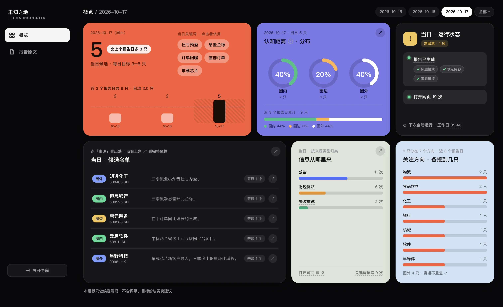
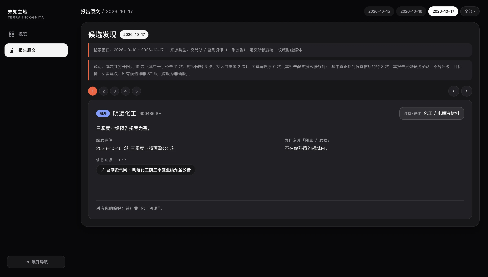
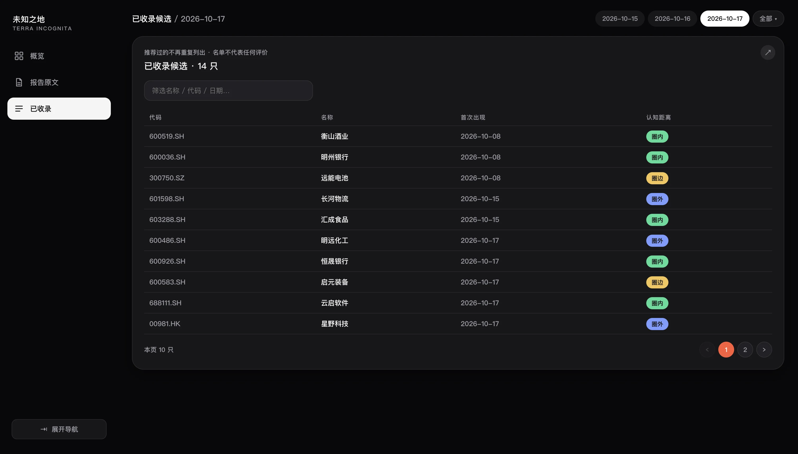

# 未知之地（terra incognita）

> 每天替你找出 **3–5 只“圈外”的 A 股 / 港股候选**（stock discovery · A-shares + HK）。

人总会反复看自己已经熟悉的东西。**未知之地**每天自动扫一遍公开披露与权威财经信息，挑出值得进一步了解的公司，
并明确标出它离你的“已知领域”有多远。**每天至少带 1 只完全陌生的**，帮你拓宽认知边界。

它**只做发现**：不评级、不给目标价、不给买卖建议；每个结论都附来源链接。

## 三个页面

下图是概览页（示例数据，公司为虚构）。另两页折叠在下面，点开看。



当日候选数、认知距离分布（圈内 / 圈边 / 圈外）、运行状态、候选名单、信息来源构成、关注方向。

<details>
<summary>报告原文 · 点开看图</summary>



当天的报告：检索窗口与说明，逐张切换候选卡（赛道、逻辑、关键词、触发事件、来源、为什么陌生、风险提示）。

</details>

<details>
<summary>已收录候选 · 点开看图</summary>



推荐过的全部候选（代码 / 名称 / 首次出现 / 认知距离），用于避免重复推荐。

</details>

## 每天它做什么

1. 读 `profile.md`（你的偏好）与 `seen.md`（已推荐过的，用来去重）
2. 先套用硬性筛选（A 股排除 ST；港股排除仙股与长期停牌；排除夕阳领域）
3. 按你的“关注方向”搜索近 **7–30 天**的公开信息（公告、政策、行业动态）
4. 产出 **3–5 只候选**，每只标注**认知距离**：圈内（你熟悉）/ 圈边（沾边）/ 圈外（完全陌生）
5. 写报告、更新看板、把新候选记入去重记忆

## 快速开始

> 需要 **opencode v2 或更高**，并且**登录过一个模型服务商**（用哪家都行，见 SETUP.md）。
> 密钥存在 opencode 的全局凭证里，本项目不保存密钥。

```bash
cd /path/to/terra-incognita
opencode          # 打开交互界面
/setup            # 输入这个斜杠命令，按访谈回答几个问题
```

配置只需一次。之后它会按你设的时间自动跑。详细步骤见 **[SETUP.md](SETUP.md)**。

想立刻看效果：`./run.sh`，然后浏览器打开生成的 `dashboard.html`（单文件，双击即可）。

## 什么能换、什么不能换

| | 能不能换 | 说明 |
| --- | --- | --- |
| **模型服务商** | **随便换** | 未知之地只记 `provider/model`，不绑定任何一家（可选项见 [SETUP.md](SETUP.md#用哪家的模型都行)） |
| **Agent 运行时** | **目前只支持 opencode** | 每日运行靠 `opencode run` 调起；换 Claude Code / Cursor / Codex CLI 需另写适配层 |

换运行时时，agent 流程、报告格式、产物校验、看板都能直接复用；要重写的只有适配层。

## 组成

```
AGENT.md                     discovery agent 的行为规范（市场范围 / 来源政策 / 报告格式 / 硬性边界）
profile.example.md           偏好模板；你的真实偏好写在 profile.md（本地文件，不入库）
seen.md                      去重记忆：已收录的候选
run.sh                       一次运行：跑 agent → 校验产物 → 生成看板 → 提交
scripts/verify_report.sh     产物校验：标题 / 候选内容 / 来源链接（任一缺失即判失败并重试）
scripts/install-schedule.sh  定时任务：安装 / 改时间 / 改频率 / 查看（macOS / Linux / Windows）
scripts/gen_dashboard.py     看板生成：解析报告与去重记忆，算出全部统计
scripts/dashboard.js         看板渲染层
scripts/dashboard_template.html  看板骨架与样式
reports/                     每日报告（YYYY-MM-DD.md）
dashboard.html               生成物，不入版本库
```

## 术语

| 词 | 含义 |
| --- | --- |
| 认知距离 | 一只股票的赛道离你“已知 / 熟悉领域”有多远，只有三档 |
| 圈内 / 圈边 / 圈外 | 分别＝你熟悉的 / 和熟悉领域沾点边的 / 完全陌生的新领域 |
| 候选 | 当天新发现的股票（报告里也写作“新面孔”） |
| 已收录 | 推荐过的全部候选，仅用于避免重复推荐 |

代码一律带市场后缀：A 股 6 位（`.SH` / `.SZ` / `.BJ`）、港股 5 位（`.HK`），如 `600519.SH`、`00700.HK`。

## 定时任务

默认工作日 09:40（A 股开盘后 10 分钟）自动运行。改时间 / 频率：

```bash
scripts/install-schedule.sh status
scripts/install-schedule.sh install --time 20:30 --days daily
```

各平台差异（错过运行怎么办、时区、是否需要登录）见 **[docs/schedule.md](docs/schedule.md)**。

## 免责声明

本工具只做候选发现，**不含评级、目标价与买卖建议**。信息来自公开披露，可能存在错漏，
请以原始来源为准；投资有风险，决策请自行判断。

## License

[MIT](LICENSE)
